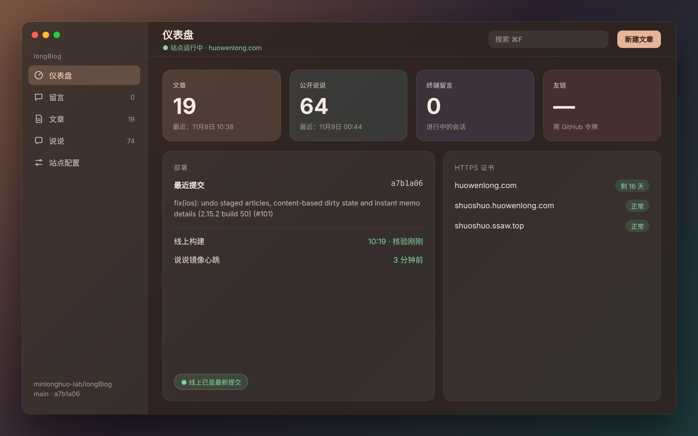

# longBlog macOS

[](https://github.com/minlonghuo-lab/longBlog-macOS/actions/workflows/macos.yml)

面向 longBlog 维护者的**原生 macOS 客户端**。不是把网页管理后台套壳，也不是放大的 iPhone 界面：采用 **SwiftUI + AppKit** 重建桌面交互，并以 **Objective-C** 保留 iOS 客户端经过迭代的业务逻辑。

> **0.2.0 预览版**：最低 macOS 14（macOS 26+ 自动启用原生 Liquid Glass 动态液态玻璃材质与原生 `NavigationSplitView` 悬浮侧栏，macOS 14–15 自动回退暖棕半透明材质）；Apple Silicon / Intel 通用 DMG。编译、原生 fixture 和窗口启动由 GitHub Actions 与本地套件验证；安装包当前为 ad-hoc 签名，未包含 Developer ID 签名或 Apple 公证。

- [安装包与预览版](https://github.com/minlonghuo-lab/longBlog-macOS/releases)
- [Actions 构建及产物](https://github.com/minlonghuo-lab/longBlog-macOS/actions/workflows/macos.yml)
- [安装和首次配置](docs/INSTALL.md)
- iOS 来源：[minlonghuo-lab/longBlog-iOS](https://github.com/minlonghuo-lab/longBlog-iOS)（与 iOS 本地优先缓存、暂存撤销与凭据策略对齐）

打开下载的 DMG，将 `longBlog.app` 拖入「应用程序」，然后从「应用程序」启动。首次使用可按 `⌘,` 打开连接设置。

## 界面与技术路线

参考用户提供的 [macOS 设计方案](docs/design/README.md)，选定方案一：暖棕底色、暖桃强调、原生液态玻璃/半透明控制层 + 实底高对比阅读与卡片层、可平滑收起的原生侧边栏、列表/详情/预览三栏工作台及卡片仪表盘。设计稿保存于 `docs/design/`；其中截图是**参考稿**，示例统计不会硬编码成在线状态。



选择混合语言，而不是完全重写或 Catalyst：

| 层 | 技术 | 理由 |
| --- | --- | --- |
| 窗口、导航、工具栏、表单、菜单栏 | SwiftUI + AppKit (`NSHostingController` / `NavigationSplitView`) | 原生 Mac 统一透明顶栏（去除顶部悬停发亮条）、AppKit 隔离容器 + GPU `CATransition` 无闪切页、丝滑侧栏收起、菜单栏快捷面板与右上角 `?` 快捷键指南 |
| 交互控件与材质分层 | macOS 26+ 原生 Liquid Glass + macOS 14–15 暖色回退 | 顶栏、暖桃/暖灰原生玻璃按钮（`.glassProminent` / `.glass`）、同心圆角可按住拖动分段胶囊、暖棕胶囊搜索框与全站交互小手光标；正文、编辑器、行号栏、缩略图与卡片保持实底 |
| 文章、GitHub、dotenv、Memos、留言 | Objective-C + Foundation | 复用原有协议、本地优先缓存与事务防护，通过 macOS 钥匙串保存令牌，并静默读取可访问的凭据 |
| 编辑器与离线阅读器 | AppKit `NSTextView` + 常驻复用 `WKWebView` | 行号标尺严格裁切、增量语法高亮；阅读器首帧同步注入主题、零白闪切换、离线渲染 Markdown/KaTeX/Mermaid |
| AI 写作辅助 | Swift concurrency + URLSession | 流式预览、取消、超时和大小上限；手动核对后应用 |
| 打包 | Apple clang / swiftc / lipo / hdiutil | 不依赖第三方工程生成器，直接产出 `arm64 + x86_64` 通用 `.app` 与 DMG |

## 五个工作区与核心能力

### 仪表盘

文章、公开说说、留言和友链汇总；读取最近提交、线上构建、说说镜像心跳与 HTTPS 证书有效期。支持本地快照秒开与后台静默刷新，保存连接设置后自动重拉；缺少配置或请求失败时如实显示未配置/错误，不把示例数字当实时数据。

### 留言

longBlog 终端留言会话、消息及回复、未读状态和归档浏览。「进行中 / 归档记录」支持双列表内存缓存与平滑切页；回复发送前均经显式确认。

### 文章

本地 Markdown 包、列表/详情/阅读/纯编辑/分栏实时预览、文件附件、草稿和已发布筛选、从 GitHub 同步。

- 复用 `LBMdStore`：按篇目录、附件映射、同步基线和未决事务。
- 暂存发布/下架后集中审阅，一次原子提交多个变化；Git ref 更新为 `force:false`。
- **安全删除边界**：仅本地草稿（且不在待提交队列中）允许二次确认后删除并清理文章目录与附件；已发布文章必须先「暂存下架」并提交到远端转为草稿后才可删除。
- 冲突、账号/仓库变更和结果不明时保留恢复信息，不强推、不自动重放发布。
- 实际内容快照决定脏状态，切换阅读/编辑/分栏预览或移动光标不误标为未保存。
- 阅读器常驻复用同一文档，支持「暖纸 / 深色 / 自动」纸色即时切换，切篇与切板块零白闪。

默认本地目录位于独立 Application Support 路径，也可选择外部文件夹（如 iCloud `longNotes`）。首次同步前请备份；客户端操作会真正修改所选目录与已配置的远端内容仓库。

### 说说

复用 **legacy Memos REST** 身份验证、时间线/已归档切换、编辑、可见性、置顶/归档/恢复与永久删除及资源接口。私有缓存按账号隔离：

- **全量附件本地预取与多媒体预览**：同步列表后在后台下载附件原件，单个文件上限为 32 MiB，超限或空间不足时会报告缓存失败。时间线卡片展示本地降采样实底缩略图（图片、视频首帧、PDF 首页），详情区提供实底视觉画廊与缓存进度，点击可在内置玻璃浮层中缩放看图、多图切换、播放音视频或使用 Quick Look 预览文档。
- **两段式安全删除**：「时间线」说说先归档，「已归档」说说支持二次确认后从服务端永久删除并清理本地缓存。
- 支持范围以实现的 `/api/v1/user/me`、`/api/v1/memo`、数字 ID、`rowStatus` 和 `resourceList` 为准。

### 站点配置

从 GitHub 读取 `.env`，按分组编辑、关键词筛选、标识修改项，基于基准 SHA 校验冲突并在显式确认后提交到站点内容仓库 `main`。未修改行与注释保持原有字节；写入配置与站点部署上线相互独立。

### AI 辅助、快捷键指南与菜单栏面板

- **AI 写作辅助**：文章编辑器内生成/润色摘要、润色正文、从文末续写。配置自己的 HTTPS OpenAI-compatible 接口与模型；请求前明确告知发送内容，结果预览后手动应用。
- **快捷键指南（`⌘/`）、状态坞与菜单栏快捷面板**：点击右上角 `?` 或按 `⌘/` 打开分类快捷键指南；左侧底部状态坞集成仓库状态、连接设置与深浅色切换；窗口支持自由缩放及 `⌃⌘Z` / 双击标题栏铺满屏幕（保留菜单栏与程序坞）；菜单栏面板支持查看未读留言与待提交计数或快速新建草稿。

具体已实现路径与移植差异见 [UI 移植记录](docs/UI-PORT.md)、[业务层移植记录](docs/CORE-PORT.md)、[阅读器边界](docs/READER-PORT.md)。

## 快捷键

| 快捷键 | 操作 |
| --- | --- |
| `⌘/` | 显示或隐藏快捷键指南浮层 |
| `⌘N` / `⌘⇧N` | 新建文章 / 写说说 |
| `⌘E` | 切换阅读 / 编辑 |
| `⌘⌥R` / `⌘⌥E` / `⌘⌥P` | 阅读 / 仅编辑 / 编辑 + 实时预览 |
| `⌘\` | 显示或隐藏左侧导航栏 |
| `⌃⌘Z` | 窗口铺满屏幕 / 还原默认尺寸（非系统全屏空间） |
| `⌘S` | 保存 / 审阅配置修改 |
| `⌘⇧P` | 审阅待提交文章 |
| `⌘F` | 搜索当前列表（编辑器内为文内查找） |
| `⌘R` | 刷新当前工作区 |
| `⌘1`–`⌘5` | 切换工作区 |
| `⌘,` | 连接设置 |

编辑器格式：`⌘B` 粗体、`⌘I` 斜体、`⌘⇧X` 删除线、`⌘⇧C` 行内代码、`⌘K` 链接、`⌘⇧I` 图片、`⌘⌥1–3` 标题、`⌘'` 引用、`⌘⇧8/7/9` 无序/有序/任务列表、`⌘⇧K` 代码块、`⌘⌥T` 表格、`⌘⌥M` 公式。截图可直接粘贴，文件可拖入编辑器作为附件。

## 构建与 DMG

### GitHub Actions（推荐）

`push main`、Pull Request 和手动 `workflow_dispatch` 均触发 `.github/workflows/macos.yml`：

1. `macos-15` runner，核对 Xcode/Swift 工具链。
2. Python/JavaScript 边界回归；无运行时 npm/SPM 依赖。
3. 清空对象产物，分别为 `arm64` 和 `x86_64` 完整编译，`lipo` 验证双架构。
4. 执行原生业务 fixture 与 AI 端点 fixture（不访问私人服务）。
5. 资源/许可完整性检查、ad-hoc 签名核验、`hdiutil` 生成并校验 DMG。
6. 启动真实原生窗口，生成仪表盘冒烟截图。
7. 上传 DMG + SHA256，以及供验收的 `.app.zip` 与截图。

带 `v*` 标签的构建成功后发布 **GitHub 预览 Release**；普通构建的产物保留 30 天，下载 Actions artifact 通常需要登录 GitHub。预览 Release 的 DMG 可公开下载。

### 本地 Mac

安装 Xcode（含 Command Line Tools）、Python 3、ripgrep，然后在仓库根目录运行：

```sh
python3 -m unittest discover -s tests -p 'test_*.py' -v
bash scripts/build.sh
bash scripts/test_reader.sh
open build/longBlog.app
```

`scripts/build.sh` 会自动执行双架构编译、`CoreFixtures`（180 项业务与缓存断言）、`EditorFixtures`（5 万字语法高亮基准）与 `AIEndpointFixtures`（19 项离线边界校验），并输出 `build/longBlog-0.2.0-universal.dmg` 与 `build/SHA256SUMS.txt`。可设置非秘密参数 `VERSION`、`GITHUB_RUN_NUMBER`；构建无需任何后端 Token、签名证书或 Apple ID。

## 安全与验收边界

- 独立 Bundle ID：`com.huowenlong.longblog.macos`；令牌保存在 macOS 登录钥匙串中。应用静默读写凭据。若钥匙串已锁定，需先解锁；若升级后旧项目无法读取，可在连接设置重新填写对应令牌。
- 当前为非 App Sandbox 桌面应用；选择目录不是隔离整个进程权限的安全沙盒。阅读器仍单独执行路径/导航限制（`O_NOFOLLOW`、符号链接逃逸拦截与严格 CSP）。
- GitHub Token、Owner Key、Memos Token、AI Key 不存进普通 `UserDefaults`、源码或构建日志。
- WKWebView 使用临时数据存储、CSP、内容清洗及受控资源 scheme；外部 HTTPS 链接只在用户点击时交给系统。
- 本仓库不包含真实服务凭据、后端、自动部署服务或第三方远程脚本。
- CI 不是端到端私人服务验收：没有使用用户数据执行文章发布、留言回复、Memos 编辑/删除或 `.env` 提交。

## 来源与许可

见 [NOTICE.md](NOTICE.md)。保留上游权利与第三方阅读器/字体许可，不擅自给没有统一许可证的上游代码换许可证。
