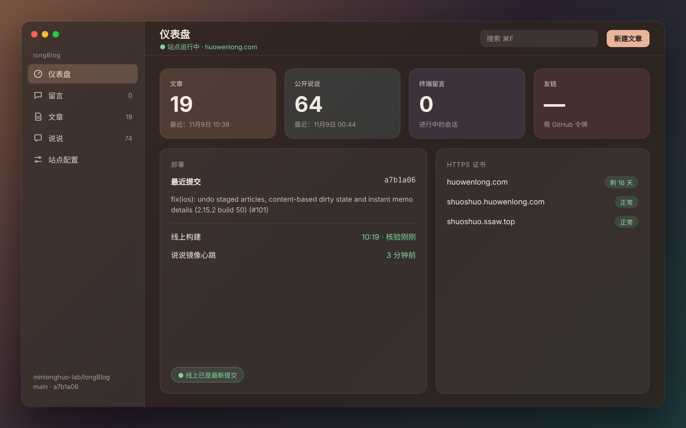
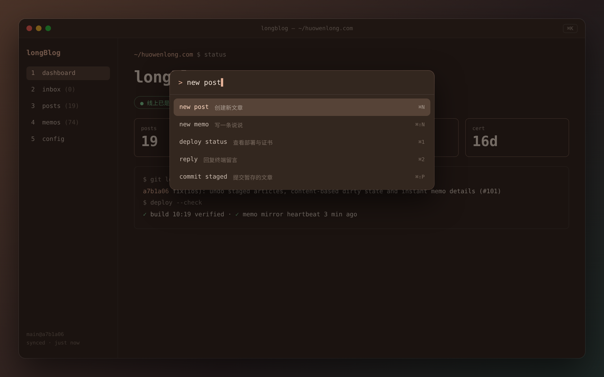
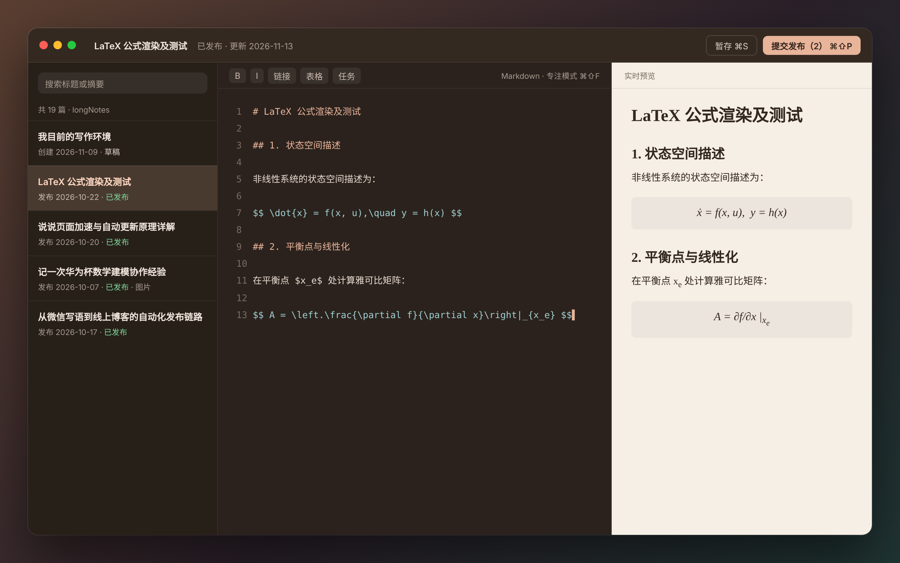
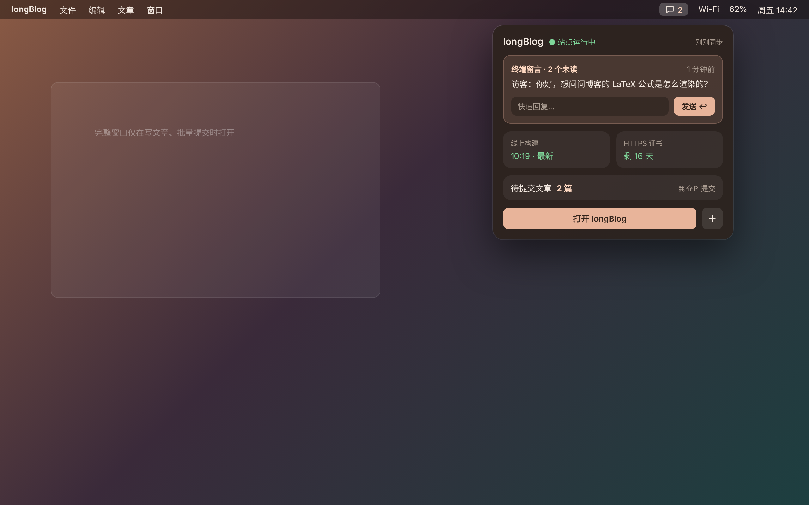
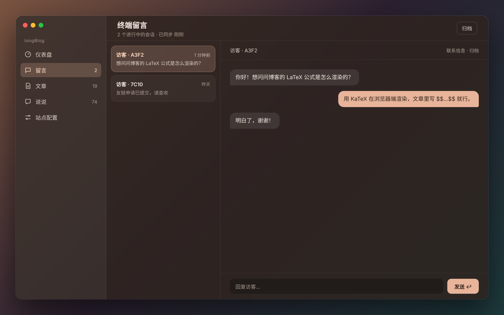
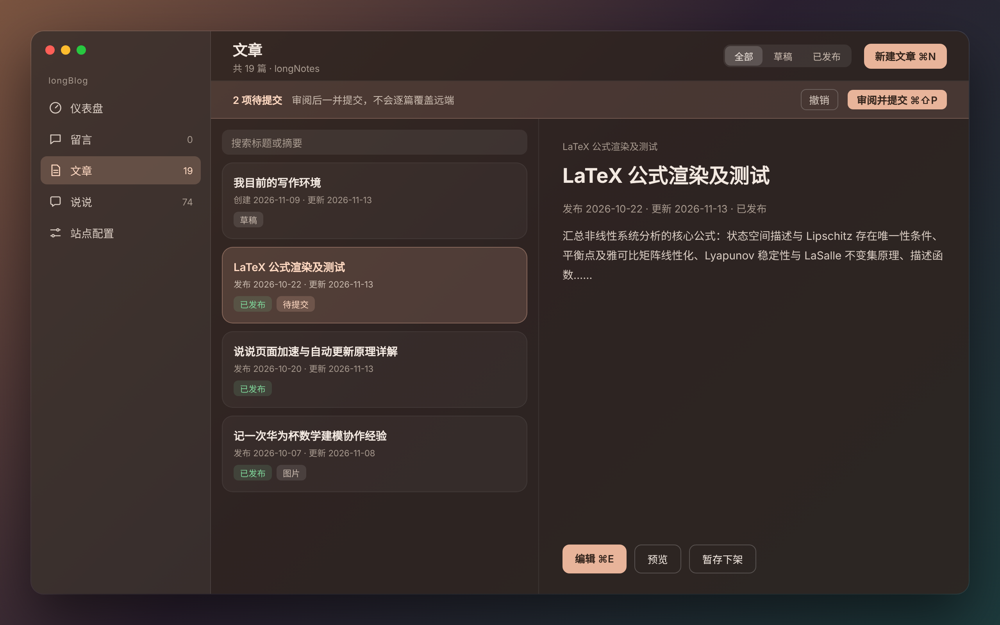
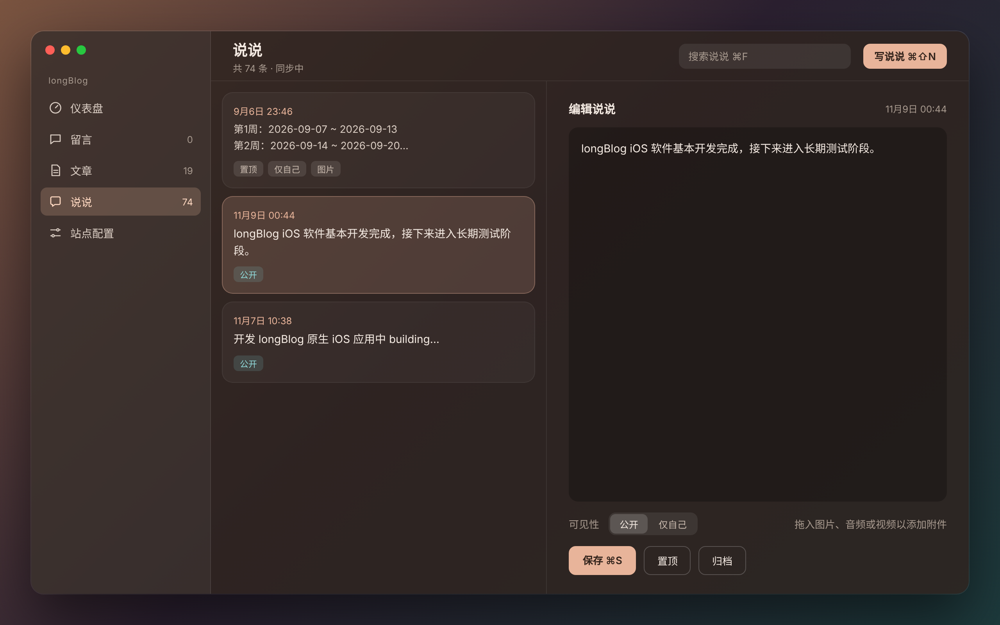
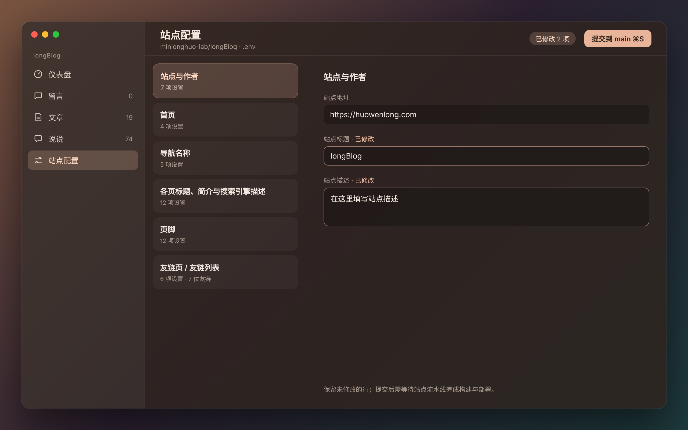

# longBlog macOS 界面设计方案

> 把 longBlog iOS 客户端移植到 macOS 的界面设计稿。包含四种风格方案的对比，以及**已选定的方案一（原生 Tahoe 玻璃风）**的全部板块设计与设计规范。
> 日期：2026-11-13　画板尺寸：1280 × 800（窗口 1200 × 720）

## 目录

1. [设计前提](#1-设计前提)
2. [四种风格方案对比](#2-四种风格方案对比)
3. [已选方案一：设计规范](#3-已选方案一设计规范)
4. [已选方案一：各板块界面](#4-已选方案一各板块界面)
5. [iOS 模块与 macOS 界面的对应关系](#5-ios-模块与-macos-界面的对应关系)
6. [移植建议与注意事项](#6-移植建议与注意事项)
7. [数据说明与待办](#7-数据说明与待办)
8. [压缩包内容](#8-压缩包内容)

---

## 1. 设计前提

现有 iOS 应用的气质是"温暖的终端"：暖棕色深色背景、玻璃质感卡片、桃色强调色，部分文案带终端风格（如 `~/huowenlong.com $ status`）。移植到 macOS 时沿用这套气质，只改变布局：

- iOS 底部五个标签 → macOS 左侧边栏，五个入口不变：仪表盘、留言、文章、说说、站点配置。
- 单列滚动 → 多栏（列表 + 详情），充分利用大屏。
- 触摸操作 → 键盘快捷键、拖拽、右键菜单、菜单栏。

---

## 2. 四种风格方案对比

| 方案 | 风格 | 特点 | 优点 | 代价 |
| --- | --- | --- | --- | --- |
| 1 | 原生 Tahoe 玻璃风 | 标准侧边栏 + 工具栏 + 半透明材质 | 最像系统应用，改动最小，与现有玻璃卡片一致 | 辨识度一般 |
| 2 | 暖色终端风 | 等宽字体、细边框、`⌘K` 命令面板 | 辨识度最高，最贴合博客风格 | 需自维护视觉规范，可读性要多测 |
| 3 | 写作工作台 | 文章列表 / Markdown 编辑 / 实时预览三栏 | 最适合写作，发挥键盘与大屏优势 | 仅文章页受益 |
| 4 | 菜单栏常驻面板 | 菜单栏图标 + 未读数 + 快速回复 | 随手查看，不打开主窗口 | 不适合作为唯一界面 |

### 方案 1 · 原生 Tahoe 玻璃风（已选定）



### 方案 2 · 暖色终端风



### 方案 3 · 写作工作台



### 方案 4 · 菜单栏常驻面板



> 方案 3、4 的思路可以作为方案 1 的后续增强：文章页可升级为三栏写作布局，菜单栏面板可作为留言通知入口（见第 6 节）。

---

## 3. 已选方案一：设计规范

### 3.1 窗口结构

```
┌──────────────┬────────────────────────────────────────────┐
│  侧边栏 230   │ 工具栏 64：标题 + 状态 + 搜索 + 主操作按钮      │
│  ● ● ●       ├──────────────┬─────────────────────────────┤
│  仪表盘       │  列表 (290–430) │  详情 / 编辑区（自适应）       │
│  留言  (0)    │              │                             │
│  文章  (19)   │              │                             │
│  说说  (74)   │              │                             │
│  站点配置     │              │                             │
└──────────────┴──────────────┴─────────────────────────────┘
```

- 窗口圆角 16，内部分隔线 `rgba(255,255,255,0.07)`。
- 侧边栏五项，选中项高亮；数字徽标显示未读数或总数。
- 仪表盘为卡片网格；留言、文章、说说、站点配置为"列表 + 详情"。

### 3.2 颜色

| 用途 | 数值 |
| --- | --- |
| 窗口背景 | `rgba(46,36,31,0.86)`（半透明材质） |
| 侧边栏背景 | `rgba(255,255,255,0.05)` |
| 强调色（主按钮） | `#e8b49a`，按钮上的文字 `#33241c` |
| 选中项背景 / 文字 | `rgba(232,180,154,0.22)` / `#ffd9c2` |
| 主文字 | `#f3e9e1` |
| 次要文字 | `#d9ccc2` |
| 弱化文字 | `#a89a8f` |
| 成功 / 正常 | `#7fd69a`（底色 `rgba(127,214,154,0.14)`） |
| 统计卡片底色 | 桃色 `rgba(232,180,154,0.16)`、青色 `rgba(120,190,190,0.14)`、紫色 `rgba(150,140,210,0.14)`、玫红 `rgba(220,120,130,0.14)` |
| 桌面背景（示意） | `#7a5440 → #2b2030 → #1d3a3c` 斜向渐变 |

### 3.3 字体与圆角

- 中文与界面：系统字体（SF Pro / PingFang SC）。
- 数字、提交哈希：等宽（`ui-monospace`）。
- 圆角：窗口 16、卡片 12–16、按钮与输入框 9–10、徽标 6（胶囊 999）。

### 3.4 常用组件

- **主按钮**：桃色底、深色文字、半粗体，圆角 9，高 32–38。
- **次要按钮**：1px 描边 `rgba(255,255,255,0.2)`。
- **分段控件**：圆角 9 的深色槽，选中段亮一档。
- **状态徽标**：已发布（绿）、草稿（灰）、待提交（桃）、公开（青）、仅自己（灰）。
- **输入框**：`rgba(0,0,0,0.25)` 底，已修改的字段加桃色描边并标注"已修改"。

### 3.5 键盘快捷键（设计稿中出现的）

| 快捷键 | 动作 |
| --- | --- |
| `⌘N` | 新建文章 |
| `⌘⇧N` | 写说说 |
| `⌘E` | 编辑所选文章 |
| `⌘S` | 保存 / 暂存 / 提交配置 |
| `⌘⇧P` | 审阅并提交待发布的文章 |
| `⌘F` | 搜索 |

---

## 4. 已选方案一：各板块界面

### 4.1 仪表盘


- **统计卡片**：文章 19、公开说说 64、终端留言 0、友链（需 GitHub 令牌）。
- **部署卡片**：最近提交 `a7b1a06` 及提交信息；线上构建时间；说说镜像心跳；"线上已是最新提交"状态。
- **证书卡片**：三个域名的 HTTPS 证书剩余天数。
- 工具栏：站点运行状态、搜索、"新建文章"。

### 4.2 留言



- 左：会话列表（未读会话高亮、最近消息预览）。右：聊天气泡，访客在左，站长回复（桃色）在右。
- 底部回复框，`↩` 发送。工具栏提供"归档"入口，另有联系信息和归档。
- 窗口标题和侧边栏徽标显示未读数。

### 4.3 文章



- 顶部分段控件：全部 / 草稿 / 已发布；右上"新建文章 ⌘N"。
- **待提交条**：显示"N 项待提交"，提供"撤销"与"审阅并提交 ⌘⇧P"，对应 iOS 的"暂存 → 批量提交"流程（一个 commit 更新 `main`，不逐篇覆盖）。
- 左：文章卡片（标题、创建/更新日期、状态徽标）。右：所选文章详情（标题、日期、摘要）与操作：编辑、预览、暂存下架。
- 后续可把右侧升级为方案 3 的"编辑 + 实时预览"三栏布局。

### 4.4 说说



- 左：时间线，卡片显示时间、正文摘要、置顶 / 仅自己 / 公开 / 图片徽标。
- 右：编辑区，含正文、可见性分段控件、附件拖入提示，以及保存、置顶、归档。
- 工具栏：搜索与"写说说 ⌘⇧N"。

### 4.5 站点配置



- 左：配置分组（站点与作者、首页、导航名称、各页标题与搜索引擎描述、页脚、友链页 / 友链列表）。
- 右：所选分组的表单；已修改字段以桃色描边并标注。
- 工具栏显示"已修改 N 项"和"提交到 main"。提交后仍需等待站点流水线完成构建与部署。

---

## 5. iOS 模块与 macOS 界面的对应关系

| macOS 板块 | 对应 iOS 源码 | 说明 |
| --- | --- | --- |
| 仪表盘 | `LBDashboard.m`、`LBSite.m` | 站点数据、部署标记、证书探测 |
| 留言 | `LBInbox.m`、`LBChat.m`、`LBAPI.m`、`LBSync.m`、`LBArchive.m` | 终端留言协议与会话同步 |
| 文章 | `LBMdStore.*`、`LBPostEditor.*`、`LBPostReader.*`、`LBMarkdown.*` | 本地文章、暂存、批量提交、阅读渲染 |
| 说说 | `LBMemosClient.m`、`LBMemosTimeline.m`、`LBMemosEditor.m`、`LBMemosDetail.m`、`LBMemosDiskCache.*` | legacy Memos REST 协议与缓存 |
| 站点配置 | `LBConfig.m`、`LBEnv.m`、`LBSettings.m` | `.env` 解析与编辑 |
| 窗口与导航 | `LBApp.m`、`LBNavigationController.*` | 需改为侧边栏式导航 |

业务层（存储、网络、协议）应尽量复用，只重做界面层。

---

## 6. 移植建议与注意事项

**路线选择**

- **Mac Catalyst**：复用大部分 Objective-C + UIKit 代码，改动小；侧边栏、菜单栏、快捷键需手工适配。
- **AppKit / SwiftUI 重写界面层**：体验更原生，工作量大；业务层仍可复用。

**需要提前处理的点**

1. **构建环境**：现有构建依赖手机端 ios-dev 工具链，macOS 版需要装有 Xcode 的 Mac 来编译和签名。
2. **后台刷新**：iOS 版用 `BackgroundTasks` 和 `UIBackgroundModes` 提示新留言；macOS 上没有这套机制，需要改为应用内定时轮询，或配合菜单栏常驻（方案 4）实现。
3. **Keychain**：现有 token 以 `kSecAttrAccessibleAfterFirstUnlockThisDeviceOnly` 存储。macOS 上的访问方式与 iOS 不同，Catalyst 下需要实际验证读写是否正常。
4. **导航**：`LBApp.m` 使用 `UITab`，需要确认在目标平台上能否呈现为侧边栏。
5. **阅读器**：`WKWebView` 加随包 HTML 资源的方案在 macOS 上可直接沿用。
6. **输入**：补充拖拽附件、右键菜单、多窗口与菜单栏命令。

**可延伸的增强**

- 文章页升级为三栏写作布局（方案 3）。
- 增加 `⌘K` 命令面板（方案 2 的思路）。
- 菜单栏常驻面板显示留言未读数和部署状态（方案 4）。

---

## 7. 数据说明与待办

- 文章标题、日期、统计数字、提交号 `a7b1a06`、证书剩余天数取自你提供的 iOS 截图。
- **示例数据（非真实）**：留言页的会话与对话内容、菜单栏方案里的"2 个未读"与访客消息、站点配置里的"已修改 2 项"与"站点描述"占位文字。你当前的终端留言数实际为 0。
- 设计稿由 HTML 渲染，未在真机或 macOS 上做过交互验证。
- 待办：文章编辑器页面、深浅色模式、窄窗口自适应、无障碍（VoiceOver）标注。

---

## 8. 压缩包内容

```
longBlog-macOS-design/
├── README.md          # 本文档
├── images/            # 8 张界面图（2560×1600 PNG）
│   ├── scheme1-glass-dashboard.png
│   ├── scheme2-terminal-warm.png
│   ├── scheme3-writing-studio.png
│   ├── scheme4-menubar.png
│   ├── chosen-inbox.png
│   ├── chosen-posts.png
│   ├── chosen-memos.png
│   └── chosen-config.png
└── source/            # 对应的 HTML 源文件（可用浏览器直接打开）
```
